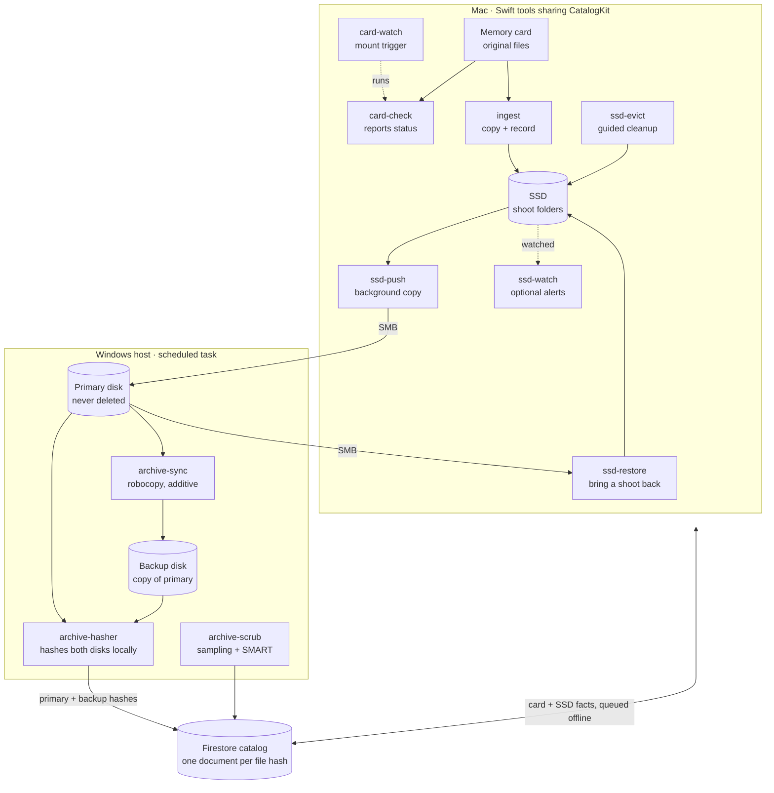

# negatives: Design Doc

Oct 24, 2026 · @Luke

## Why

A memory card is often the only copy of a shoot for days, and today the decision to format it rests on memory. negatives replaces that with one answer based on hashes: this card, this file, is safe to delete, or it isn't.

- **Formatting too early loses work.** Nothing currently proves both archive copies exist and match the card before a format.
- **Formatting too late causes confusion.** A forgotten card ends up with a mix of copied and new files, and re-copying it creates duplicates.
- **Filenames can't be trusted.** DCIM numbering rolls over at 9999 and repeats across cards and cameras, so "I already have DSC00001" means nothing.
- **Existing offload tools stop at the offload.** Hedge and ShotPut Pro verify a copy in the moment, but can't say whether a file is already archived however it got there, or manage a working SSD against verified backups.
- **Editing shouldn't wait for backups.** Work starts on the SSD immediately, and SSD space is freed only when it's provably safe.

## Assumptions

The design is built around one person's home setup: a Mac for editing and a Windows machine holding the archive, which the Mac reaches over SMB network shares.

**Expected workflow**

- Shoots produce both photos and video, from cameras of several brands, on cards that are reused after formatting.
- After a shoot, a card goes into the Mac, its files land on the local SSD, and editing starts right away in desktop photo and video apps that work directly on the files in the shoot folder.
- Originals aren't intentionally modified, and editing apps leave raw and video files untouched. They do create new files in the shoot folder (metadata sidecars, panoramas, rendered videos, project files), and some write ratings and metadata directly into JPEG and DNG files.
- The Mac is sometimes offline, for example while traveling, so ingest must work without a connection.
- The Windows machine is usually on at home, hosts the primary and backup disks, and runs scheduled tasks. It isn't always on, but it must be on for new files to reach the archive; until then they simply stay Pending.
- The SSD is much smaller than the archive, and space on it is freed only when you decide to, a whole shoot folder at a time. The assumption is that a single shoot always fits on the SSD.
- The working SSD is formatted APFS, so working copies can be clones of the locked originals. ingest refuses to run on any other file system.
- Cards sometimes sit unformatted for a while, or an old card turns up later.
- The archive holds on the order of millions of files and tens of terabytes. Loading them into Firestore the first time goes beyond the free daily write quota, so that one-time load is paid; ongoing use fits the free tier.

**Backup principles**

- **3-2-1:** three copies (primary, backup disk, online backup), on two kinds of storage (local disks and cloud), with one offsite (the existing online backup). The primary and backup disks share one machine, so they protect against a disk failure, not theft, fire or a power surge; the online backup covers those.
- **A copy isn't a backup until it's verified.** Every copy is checked by hash against the bytes that came off the card, at the place the bytes live.
- **The card is a copy until it's formatted.** It stays the safety net until both archive copies are verified.
- **The working SSD is never a backup.** It's where editing happens, and it may hold changes that aren't archived yet.
- **Backups are additive.** Mistakes on one copy, such as a deletion or an overwrite, must not spread to the others. This assumes the online backup also keeps deleted and older versions. It's hash-based, so moving or renaming files doesn't re-upload them.
- **Restores should be tested.** Occasionally pull a file back from each copy to confirm it opens.

## Goals and principles

A memory card is only cleared once every file on it has a hash-verified copy on both the primary and the backup archive disk. Editing can start from the SSD before that point.

**Goals**

- Know, for any card, which files are safe to delete, which are pending, and which were never copied, regardless of when or how they were copied.
- Verify every copy with an MD5 that matches the hash read from the card.
- Start editing from the SSD immediately; never wait on archive copies.
- Free SSD space only when you ask, through a guided review that deletes nothing but files verified on both archive disks.
- Record ingests while offline (Mac) and sync them later.

**Non-goals**

- Online/cloud backup of the archive. Existing cloud backup software already handles it.
- RAID or block-level replication. The archive stays plain file copies.
- Formatting cards. Tools say when a card is safe; the camera does the format.
- Managing edits, catalogs or sidecars, beyond archiving them as derived files.
- Shoots larger than the SSD. ingest refuses a card that won't fit, so such a shoot would need a direct-to-archive path, left for later if it ever comes up.

**Principles**

- **Small single-purpose tools.** Each component does one job, runs on its own, and talks to the others only through the catalog.
- **Identity is the hash.** Filenames and paths are attributes, never identity.
- **Append-only facts.** Components record what they observed; they never edit another component's facts.
- **Fail safe.** Any missing, stale or unreadable fact means "not safe yet", never "safe".
- **Verify where the bytes live.** Archive hashes are computed on the Windows host from local disks, never read back over SMB.

## System overview

Ten small tools on two machines share one Firestore catalog, plus one manual utility for old Lightroom catalogs (see Extra tools). The Mac tools copy and record what they saw; only the Windows hasher, reading the disks locally, can make a file Safe.



The Mac never decides a file is Safe on its own. It reads that from facts the Windows host publishes after hashing both disks.

**Why an online catalog.** Every copy of every file is recorded by content hash in one catalog that both machines can reach from anywhere. That answers questions a folder of files can't:

- *Is this file already safe?* For any file on any card, however long ago and by whatever means it was copied, regardless of its name or path.
- *Which cards can I format?* Even an old card found in a drawer, or one with a mix of copied and new files.
- *What can I free from the SSD?* Decided from verified facts, not from remembering what was backed up.
- The machines coordinate without talking to each other directly: the Mac records what it copied (offline too, syncing later), the archive host records what it verified, and each reads the other's facts.
- The catalog lives outside both machines, so it survives losing either one, and it keeps history such as card sessions and per-card errors.

**How this differs from existing tools.** Offload tools such as Hedge and ShotPut Pro verify a copy at the moment it's made, one session at a time. Photo importers typically spot duplicates by filename, date and size rather than content. Sync and backup tools (robocopy, rsync, online backup) copy and protect files but never check them against what came off the card. negatives keeps a lasting, content-addressed record of every verified copy, keeps re-verifying the archive over time, and answers the card-centric question none of them do: is it safe to format this card?

## Data model

The catalog is one Firestore collection, `files`, with one document per unique file content, keyed by its MD5 (lowercase hex). Each component owns specific fields and writes them with set-with-merge, so concurrent writers never overwrite each other and replayed writes are harmless.

| Field | Contents | Written by |
| --- | --- | --- |
| `size` | Bytes | First writer (identical for all) |
| `cards.<cardKey>` | Card ID, relative path on card, time seen | card-check, ingest (Mac) |
| `primary.<pathKey>` | Archive-relative path, size, mtime, verified-at | archive-hasher (Windows) |
| `backup.<pathKey>` | Archive-relative path, size, mtime, verified-at | archive-hasher (Windows) |
| `ssd.<pathKey>` | Working and .originals paths, size and mtime at ingest, copied-at, pushed-at | ingest, ssd-push, ssd-evict (Mac) |

Other collections:

- `status/archive-hasher`: last run start, last success, files published. It also holds the watcher's heartbeat. The Mac warns when the heartbeat is older than a few hours or the last full run is older than about a day and a half.
- `conflicts`: a path whose content changed on primary, or a backup file whose hash never matches. Written by Windows, resolved by hand.
- `cardSessions`: one document per card session (volume UUID, shoot folder, card folder, camera model, first ingest, plus a few file paths and sizes for confirmation). Written by ingest.

**Keys and paths**

- `pathKey` is a short hash of the normalized path, because Firestore field names can't safely hold slashes. The full path lives in the value.
- Paths are stored relative to the archive or SSD root, with `/` separators and Unicode NFC. macOS often produces NFD filenames, which otherwise won't match what Windows reports for the same file.
- `cardKey` is the card's volume UUID. It stays the same until the card is formatted, so a re-inserted card is recognized and can continue its previous shoot. A format creates a new UUID, which counts as a new card.

**Derived states** (computed by readers, never stored)

| State | Rule |
| --- | --- |
| Safe | A `primary` entry and a `backup` entry, both verified |
| Pending | Seen on a card or SSD, but missing one or both verified archive entries |
| Not copied | No document for the hash |

All writes are merges of facts, so no write needs a transaction. That's what lets the Mac queue writes offline.

## Folder layout

Every card keeps its own folder structure (DCIM, PRIVATE/M4ROOT and so on) inside a per-card folder, so DCIM's 9999-file rollover and two cards with the same paths never collide. On the Mac, everything for a shoot lives in its shoot folder: working copies at the card paths, and the locked pristine originals at the same paths inside a hidden .originals/ folder, so moving, freeing or restoring a shoot means one folder. On the archive, each shoot folder holds its own Originals/ and Derived/ folders, and a small .negatives marker file tells the tools it's a negatives shoot.

**Mac SSD**

```text
EditSSD/
└── Shoots/
    └── 2026-10-18 Coast/                 everything for one shoot
        ├── .originals/                   pristine originals, locked, hidden
        │   ├── ILCE-7M4-01/DCIM/100MSDCF/DSC09998.ARW
        │   └── ILCE-7M4-02/…
        ├── ILCE-7M4-01/                  working copies (APFS clones), editable
        │   ├── DCIM/100MSDCF/DSC09998.ARW
        │   ├── DCIM/101MSDCF/DSC00001.ARW
        │   └── PRIVATE/M4ROOT/CLIP/C0001.MP4
        ├── ILCE-7M4-02/
        └── Exports/                      derived work, anywhere in the shoot
            └── coast-pano.tif
```

**Windows primary** (the backup disk mirrors it)

```text
P:\
├── 2026-10-18 Coast\                    a negatives shoot
│   ├── .negatives                       marker file
│   ├── Originals\                       from .originals, never overwritten
│   │   └── ILCE-7M4-01\DCIM\100MSDCF\DSC09998.ARW
│   └── Derived\                         changed or new files from Shoots/, replaceable
│       ├── ILCE-7M4-01\DCIM\100MSDCF\DSC09999.JPG   rated JPEG, same position
│       ├── ILCE-7M4-01\DCIM\100MSDCF\DSC09998.xmp   sidecar
│       └── Exports\coast-pano.tif
└── 2019-05-04 Beach\                    a legacy shoot, left as it was
```

**Naming**

- **Shoot folder:** the latest capture date on the card, plus an optional description you type at ingest (`2026-10-18 Coast`).
- **Card folder:** the camera model from the files' EXIF plus a counter within the shoot (`ILCE-7M4-01`, `DJI-Mini4-01`). Every brand writes a Model tag.
- **Windows-safe names:** ingest rejects names containing `: * ? " < > |` or ending in a space or period, before copying anything.

**Card sessions**

- ingest looks up the card's volume UUID in `cardSessions`. A match only counts if a few files on the card match the session's recorded paths and sizes. Otherwise it's a new session, which covers rare UUID collisions and offline cache misses.
- **Confirmed match:** skip files already ingested. If the card also has new files, always ask where they go: continue the previous shoot in the same card folder (an incomplete copy) or start a new shoot with its own folders. The prompt shows how many new files there are and their capture dates, with a Preview button that opens the first new file (earliest capture) in Quick Look.
- **New session:** take the next free counter for that camera model within the shoot. Counters come from `cardSessions`, not the SSD, so a number is never reused after ssd-evict frees a folder.
- **Formatted card:** gets a new UUID, so it's always a new session.
- **Mixed-camera card:** named after the first camera model found on it.
- **Physical card ID:** each card carries a short ID written on it: a letter for the card type plus a sequence number, such as S01 for SD or C01 for CFexpress. Write it with a fine permanent marker on the label, away from the contacts, or on the case for tiny cards. Numbers are never reused, even after a card is retired.
- At the start of a new session, ingest asks for the ID, suggests the last one seen with that card's capacity, and allows skipping. It's stored in `cardSessions`, so card-check notifications can name the card and a per-card history (sessions, read errors, hash mismatches) can show one that is going bad. It never affects folder names.

## Windows components

Three tools run in sequence from one scheduled task on the machine that hosts both archive disks. None of them ever deletes from the primary disk.

**archive-sync** (PowerShell wrapping robocopy)

- Copies primary to backup in two passes, never with `/MIR` or `/PURGE`. Pass 1 copies everything additive-only (`/E /XC /XN /XO /R:2 /W:5 /LOG+:<log>`), excluding each negatives shoot's `Derived\` folder by full path (`/XD`). Pass 2 loops over those `Derived\` folders and copies them with overwrites allowed, so replaced renders reach the backup.
- Interprets robocopy exit codes (0 to 7 = success, 8+ = failure) and exits with a plain 0 or 1 for Task Scheduler.
- Reconcile step, the only time anything on an archive disk is moved: if robocopy is interrupted mid-file, it can leave a partial file on the backup disk, and the no-overwrite flags would then skip it forever. A backup file is set aside only when all of these hold: its size differs from the primary copy, the primary copy's hash is verified, and for originals that hash matches the card hash. It's moved to a quarantine folder on the backup disk, never deleted, so the next pass recopies the good version. Quarantine is emptied by hand. A same-size file with a different hash is a conflict for the hasher to report, never fixed automatically.
- Takes a lock file so a manual run can't overlap a scheduled one.
- **Legacy folders:** any shoot folder without a `.negatives` marker is legacy and covered by pass 1, additive-only, so old folders never need to move.

**archive-hasher** (Go, single binary)

- Walks both disks and hashes any file whose path, size or mtime isn't in its local state file, skipping in-progress .partial files. Hashing reads local disks only.
- Publishes `primary` and `backup` facts to Firestore in batches of up to 500, using a service account key.
- Saves progress after each batch, so an interrupted run resumes instead of starting over.
- Reports conflicts (same path, new content) under Originals/ to `conflicts` and updates `status/archive-hasher` at the end of every run. Under Derived/, a changed file is a normal replacement: its fact moves from the old hash to the new one.
- Needs no offline queue: the disks are the source of truth, so a failed publish simply happens again next run.
- Hashes legacy roots like any other root, so card-check recognizes old cards whose files were archived before negatives existed. A file that disappears from a root (for example after lrcat-pack) has its fact removed.

**archive-scrub** (Go, disk health checks)

- Runs at the end of the nightly run, while the disks are already spinning, within a fixed time budget so it never keeps them spinning for hours.
- Samples random files from both disks, favoring files checked longest ago, re-hashes them and compares against the catalog. Over many nights it works through the whole archive, tracking when each file was last checked in its local state.
- A mismatch is reported to `conflicts` as possible bit rot, naming which disk is bad. Repair is by hand, from the other disk or the online backup.
- Reads each disk's SMART data with smartctl (smartmontools runs on Windows): overall health, reallocated, pending and uncorrectable sectors, interface CRC errors and temperature. It reports any counter that rose since the last run. Some USB enclosures don't pass SMART data through; if so, it says so rather than silently skipping.
- Writes results to `status/archive-scrub`, and the Mac shows a warning on any failure, new SMART error, or a scrub that hasn't run recently.

**Credentials**

- A dedicated service account with only the Firestore user role, in a GCP project used for nothing else. Its key is readable only by the account that runs the task.
- No personal Google credentials on this machine.

**Scheduling**

- Triggered by writes, not a timer: a small always-running watcher (ReadDirectoryChangesW on the primary root) waits until 10 minutes pass with no new writes, then starts the task, with "Do not start a new instance" if a run is still going.
- Watching costs no disk activity. Disks spin only when ssd-push is already writing to them, and for the run that follows.
- Safety net: one full run every night regardless, so a missed notification (an overflowed event buffer, a crashed watcher, a reboot) costs at most a day.
- Manual trigger: from the Mac, `card-check --sync-now` writes a request to `status/sync-request`. The watcher listens for it, starts the task right away (skipping the 10-minute wait), and clears the request. On the Windows machine itself, `schtasks /run /tn negatives` does the same.
- The watcher writes a heartbeat to the status document every few hours without touching the disks, so the Mac can tell "alive, nothing new" from "watcher down".
- Set the Windows power plan's "Turn off hard disk after" so idle disks actually spin down.
- The machine isn't always on, so the task also runs at startup, and the nightly run uses "Run task as soon as possible after a scheduled start is missed". When the heartbeat stops, the Mac shows the host as offline since its last heartbeat instead of raising an alarm.
- The first full hash of the existing archive runs by hand, outside the scheduler, to avoid the default 3-day task time limit. At typical hard-disk read speeds, expect very roughly a day or two per 20 TB; the two disks are hashed in parallel, and progress is saved so the run can stop and resume.

## Mac components

Seven small Swift tools share one library. Each can run alone, and none depends on another having run first.

**CatalogKit** (shared Swift package)

- Firestore access through the Firebase Apple SDK with offline persistence on, so writes queue on disk while offline and sync later.
- Sign-in with your Google account through Firebase Auth. The token lives in the Keychain, and Security Rules limit the Mac to its own fields.
- The document schema, path normalization (relative, `/`, NFC), streaming MD5, and the derived Safe / Pending / Not copied states.
- Staleness check: warns when `status/archive-hasher` shows the Windows watcher's heartbeat or nightly run is overdue.

**card-check** (read-only report)

- Hashes every file on a mounted card, including video sidecar and index files, and reports each one as Safe, Pending or Not copied, plus one line: "safe to format" or not.
- Writes nothing except a `cards` sighting, so it's useful from day one against the existing archive.
- Offline: still hashes and reports "Not copied" vs "seen before", but never says "safe to format".

**card-watch** (card mount trigger)

- A launchd agent that runs when any volume mounts and acts only on cards: removable volumes with a DCIM or PRIVATE folder at the root.
- Runs card-check automatically. It's read-only, so it's always safe to run unasked.
- Posts a notification summarizing the card: how many files are Safe, Pending and Not copied, and whether it's safe to format.
- When there are files to copy, the notification has an Ingest button. It asks for the optional shoot description, then runs ingest and posts a second notification when it's done. ingest never starts without that click.
- Notifications with buttons need a small app bundle rather than a bare command-line tool, so card-watch ships as a minimal background app.

**ingest** (card to SSD)

- Picks the shoot folder (latest capture date + optional description) and the card folder (camera model + counter). A card re-inserted before formatting, recognized by its volume UUID; if it has both old and new files, ingest asks whether to continue the previous shoot or start a new one.
- Copies each new file from the card to `<shoot>/.originals/<card>/<path on card>`, keeping the card's structure and hashing as it reads. Files already ingested or archived are skipped.
- Locks each copy in `.originals/` with the user immutable flag (chflags uchg). No editing app ever opens `.originals/`.
- Clones each original into the same path in the shoot folder (`<shoot>/<card>/<path on card>`) with `cp -c`, with no plain-copy fallback: ingest checks the SSD is APFS before copying anything and stops if cloning isn't possible. Working copies are not locked, so apps can rate and write metadata freely.
- Records `cards` and `ssd` facts, including each working copy's size and mtime right after cloning.
- Writes only to the local SSD, never to the network.
- Checks free space before copying. If the card's new files won't fit, it copies nothing. It reports how much space the card needs and suggests running ssd-evict. ingest never deletes anything, on the card or the SSD.

**ssd-push** (SSD to primary over SMB, in the background)

- Runs from launchd on a schedule and whenever the primary share is reachable; can also be run by hand.
- **Originals:** copies each file in `.originals/` to `<shoot>/Originals/<card>/<path on card>`, additive only: never deletes or overwrites. A different file already at the target path is reported as a conflict. The first push of a shoot also writes its `.negatives` marker.
- Before pushing an original, re-hashes the `.originals/` copy against the card hash. A mismatch means corruption: it isn't pushed, it's reported, and the card stays Pending.
- An original whose hash already has a verified primary entry, at any path, isn't pushed again, so re-copied files never create duplicates in the archive.
- **Working copies:** if size and mtime match what ingest recorded, there's nothing to push. If they changed, it hashes the file; a hash still equal to the card hash also means nothing to push. A different hash makes it a derived file.
- **Derived files** (changed working copies, plus new files such as panoramas, renders, .gyroflow files and XMP sidecars) go to the same path inside the shoot's `Derived/` folder once unchanged for an hour, replacing any previous version. Later changes are pushed the same way: each run compares the file with the version it last pushed, and one that changed and has settled for an hour replaces it. Caches, proxies and temp files are skipped via a configurable exclude list.
- **Exclude list** (starting point; confirm with a test shoot):
  - Skip `Proxy/` folders. DaVinci Resolve puts proxies there when set to [proxy subfolders in media file locations](https://ymcinema.com/2022/11/18/creating-proxies-in-davinci-resolve-18-tips-tricks/), and the [Blackmagic Proxy Generator](https://jayaretv.com/edit/davinci-resolve-proxy-workflow-explained/) does by default. Also skip Resolve's cache, proxy and optimized-media working folders if they ever point inside `Shoots/`.
  - Skip Bridge's exported caches: `.BridgeCache`, `.BridgeCacheT` and `.BridgeSharedCache/` ([Adobe community](https://community.adobe.com/t5/bridge-discussions/does-adobe-bridge-remove-the-old-bridgecache-when-a-new-cache-location-is-specified-in-the/m-p/9734618)).
  - Skip each shoot's `.originals/` folder: those files are pushed as originals, never as derived. Also confirm during the test shoot that editing apps don't import hidden folders.
  - Skip `.DS_Store`, `._*` files and `*.partial` temp files.
  - Keep `.BridgeSort`: it holds Bridge's manual sort order and stacks ([Adobe community](https://community.adobe.com/t5/bridge-discussions/location-for-information-about-stacks/td-p/8887142)), so it's real work.
  - Keep XMP sidecars, `.gyroflow` projects and stabilized renders, which Gyroflow writes [next to the video by default](https://docs.gyroflow.xyz/app/advanced-usage/render-queue).
  - Lightroom keeps its catalog and previews in the catalog folder (approximate, from memory), so keep the catalog outside `Shoots/`.
  - Catalyst can edit clip metadata and export metadata sidecars; test whether edits rewrite the card's XML files, which would make them derived files.
- Writes each file under a temporary `.partial` name and renames it when complete, so archive-hasher never hashes a half-written file.
- Records `pushedAt` on the file's `ssd` entry, so card-check can show "pushed, awaiting verification".
- Share unavailable or offline: does nothing and retries next run.

**ssd-watch** (optional alerts)

- Optional: build it only if you want an extra alarm. ssd-push and ssd-evict already re-hash `.originals/` copies before relying on them.
- A launchd agent that subscribes to FSEvents on each shoot's `.originals/` folder only. Those copies are locked and never opened by apps, so any change there means corruption or a cleared lock.
- Posts one macOS notification per shoot folder and records a modified flag on the file's `ssd` entry, so card-check and ssd-evict show it even if the notification is missed.
- Changes to working copies in `Shoots/` are expected (ratings, metadata) and become derived files through ssd-push, not alerts.

**ssd-evict** (guided cleanup, only when you run it)

- Never runs on its own. Nothing is freed unless you start it and confirm.
- Lists the SSD grouped by shoot folder, with each group's size, status (Safe or Pending), and the space it would free.
- Works on whole shoot folders only: removing a shoot removes its one shoot folder, including `.originals/`. A shoot can be removed only when every original in it is Safe, and every working or derived file is either unchanged from a Safe original or Safe under Derived/.
- You choose what to remove. Only groups where every file is Safe can be selected; Pending groups are shown, with the reason they can't be selected yet.
- Before deleting, it re-checks every selected file online: it re-hashes the file and confirms that hash has verified primary and backup entries in a fresh catalog. A working copy changed since its version was archived is skipped and listed.
- Clears the lock (chflags nouchg) on each confirmed file in `.originals/` right before deleting it.
- Shows a final summary (files, size, space freed) and asks for confirmation, then deletes and removes the `ssd` facts.
- Offline or with a stale catalog, it lists only and deletes nothing.
- Takes a local lock so two runs can't overlap.
- **Legacy folders:** with `--legacy`, it reviews working folders from before negatives (kept in `Legacy/` on the SSD) by hash alone. A folder can be removed once every file in it is Safe somewhere in the archive.

**ssd-restore** (bring a shoot back to the SSD)

- Run by hand when you want to edit an archived shoot again: `ssd-restore <shoot>`, or pick from a list. Needs a connection and the primary share.
- Checks free space first and copies nothing if the shoot won't fit.
- **New-layout shoots:** copies the originals from `<shoot>/Originals` into `Shoots/<shoot>/.originals/` (locked) and clones them into the shoot folder, then lays the latest files from `<shoot>/Derived` on top at the same paths. A rated JPEG comes back rated, a panorama comes back in `Exports/`.
- **Legacy shoots:** the whole folder is treated as originals: copied into `Shoots/<shoot>/.originals/` and cloned into the shoot folder. Later edits are pushed to a `Derived/` folder inside the legacy shoot, with a `.negatives` marker. That's the only thing negatives ever adds to an old folder; the rest of it is never changed.
- Hashes every file as it lands on the SSD and compares it with the catalog's verified hash, so a bad read over SMB is caught. A mismatch is retried and then reported.
- Records `ssd` facts like ingest does. Restored files are already Safe, so ssd-push sends nothing until you change something, and ssd-evict can free the shoot again at any time.

## Safety rules and failure modes

Every failure below leaves a file in Pending, never in Safe.

**Rules**

1. A card is safe to format only when every file on it is Safe, checked online against a fresh catalog.
2. A file leaves the SSD only when you confirm it and a fresh re-hash shows it is Safe.
3. Nothing deletes from the primary disk, and only files in a shoot's Derived/ folder are ever overwritten there. The one exception is lrcat-pack, which removes packed catalog files only when run by hand and confirmed.
4. Nothing on the backup disk is deleted. A partial copy is moved to quarantine, and only when the primary copy is verified good, then recopied.
5. Archive hashes come only from archive-hasher reading local disks.

**Failure modes**

| Failure | Effect | Handling |
| --- | --- | --- |
| Interrupted robocopy copy | Partial file on backup | Reconcile moves it to quarantine (never deletes it); next run recopies |
| Corrupt write to primary over SMB | Primary hash differs from card hash | Stays Pending; re-ingest from the card |
| Scheduled task stops running | Catalog goes stale | Mac warns on stale status; nothing becomes Safe |
| Mac offline | Writes queue locally | No format or evict decisions until online |
| Original edited in place on primary | Same path, new content | Reported to `conflicts`; backup keeps the original |
| Same file on two cards | Same hash, two card sightings | One document; both cards show it as copied |
| Service account key leaked | Full Firestore read/write | Isolated project; rotate the key. Disks are unaffected |

## Walkthrough: a card with old and new files

A card that was ingested before but never formatted, then used again, is handled without duplicates when online. Offline it is still safe, but may copy some files twice.

**Online (Firestore reachable)**

1. card-watch sees the card mount and runs card-check, which hashes every file and looks each hash up in the catalog.
2. Each file lands in one of three groups: **Safe** (archived and verified on both disks), **Pending** (ingested earlier but not yet verified, for example because the Windows machine was off) or **Not copied** (new since the last ingest). The notification shows the counts and says the card isn't safe to format.
3. You click Ingest. ingest finds the card's volume UUID in `cardSessions`, confirms it by checking a few recorded files, and, because the card has both old and new files, asks whether to continue in the same shoot and card folder (an incomplete copy) or start a new shoot with its own folders. The prompt shows the new files' count and capture dates, plus a Preview button that opens the first new file in Quick Look.
4. Only the Not copied files are copied, to `.originals/` and as clones in the shoot folder. Safe and Pending files are skipped by hash, even if their shoot folder was already removed from the SSD. That's safe because the live catalog already records each of their hashes: a Safe file has verified copies on both archive disks, and a Pending file still has its locked copy in `.originals/` on the SSD (ssd-evict never removes a shoot until it's Safe) on its way to the archive. Copying either again would only make a duplicate.
5. ssd-push sends the new originals to the primary disk; archive-sync and archive-hasher copy and verify them. The next time the card is inserted, the notification says it's safe to format.

**Offline (Firestore unreachable)**

1. card-check still hashes every file, but can only look hashes up in the local Firestore cache. Files this Mac ingested or checked recently are recognized; older ones may not be in the cache, so they show as "not known offline" rather than Not copied. It never says the card is safe to format.
2. ingest looks up the card's session in the cache. If found and confirmed, it asks the same continue-or-new question, and if you continue, any file already present in that shoot's `.originals/` folder with the same path and size is skipped, so files from the earlier session aren't copied again.
3. If the session isn't in the cache, ingest starts a new card folder, and old files not on the SSD are copied again. That's safe but uses extra space.
4. Sightings and new `ssd` facts queue locally and sync when the Mac is back online. Then ssd-push finds that re-copied old files already exist on primary with the same hash, so it pushes nothing for them, and ssd-evict can later remove the duplicate folder once it's Safe.

## Migrating existing files

Existing folders stay where they are. Every shoot folder without a .negatives marker is treated as legacy: hashed and protected like Originals/. Only new ingests use the new layout.

**Windows (do this first)**

1. **Pack old Lightroom catalogs** with lrcat-pack on both disks (see Extra tools). It removes millions of small files before the first hash, which then runs much faster.
2. **Leave existing folders at the root** of both disks. Each old shoot folder stays whole, never split into Originals and Derived; their cards were formatted long ago, so they're simply protected and verified as they are. Check that no old shoot folder already contains a folder named Originals or Derived. Edits to a restored old shoot go to a Derived folder inside it.
3. **Check that primary and backup match** before turning anything on: run archive-sync in report-only mode (robocopy `/L`) and resolve differences by hand.
4. **Nothing to create:** each new shoot's folder, with its Originals and Derived folders, is created by its first push.
5. **Run the first full hash by hand** (days; see Scheduling), then enable the scheduled task and the watcher.
6. **Check the card drawer:** insert old cards and let card-check report which are already safe to format.

**Mac**

1. **Confirm the SSD is APFS** with `diskutil info`. If it isn't, wait until everything on it is verified on the primary disk, copy it off, reformat as APFS, and copy it back.
2. **Move existing working folders into `Legacy/`** at the SSD root. The tools ignore them until you run `ssd-evict --legacy`, which removes a folder only once every file in it is Safe in the archive. Files you changed since archiving show as Pending.
3. **Keep any Lightroom catalog outside `Shoots/`**, so its previews never get pushed as derived files.
4. **Don't create `Shoots/` or any shoot folder yourself.** ingest creates them on the first card.

## Extra tools

Manual utilities that ship with negatives but aren't part of the automatic flow.

**lrcat-pack** (Go, run by hand on Windows or Mac)

Old Lightroom catalogs saved inside shoot folders turn into tens of thousands of small files, mostly preview caches. lrcat-pack turns each catalog into one zip file so backups and hashing stop crawling through them.

- **What it looks for:** each `<name>.lrcat` file, grouped with its sibling `<name> Previews.lrdata`, `<name> Smart Previews.lrdata` and other `<name> … .lrdata` folders, its side files (such as `-wal`, `-shm`) and its `Backups/` folder. This layout is from memory; confirm it against a real catalog first.
- **Skips catalogs that may be open or unclean:** a `.lock` or `-wal` file next to the catalog means Lightroom is using it or didn't close it cleanly. Those are reported, not packed.
- **Dry run by default:** lists every catalog found, with its file count and size, and changes nothing.
- **`--apply`:** writes `<name>.lrcat-pack.zip` next to the catalog on the primary disk. Preview files are stored as-is (they're already compressed JPEGs) and the catalog database is compressed. Any Mac or Windows machine can open the zip without special tools, and unzipping it restores the catalog exactly.
- **Verifies before removing anything:** it re-reads the zip and compares every entry's hash with the original file, then copies the zip to the backup disk and verifies that copy the same way.
- **Removes the loose files only after you confirm**, on both disks, and only for catalogs whose zips verified on both. This is the one place negatives deletes from an archive disk, which is why it's manual, confirmed and verified first.
- archive-hasher then drops facts for the removed files and adds the zips; the online backup should still have the loose files as older versions.
- Option worth considering: previews are caches Lightroom can rebuild, so `--drop-previews` could leave them out of the zip entirely and shrink it a lot.

## Build order

Each step ships something usable on its own, and the read-only card check arrives before anything that copies or deletes.

1. **Spike: Firestore on macOS.** Sign in, write offline, quit, reconnect, confirm the write lands. This validates the riskiest assumption first. Also confirm the SSD is APFS so ingest can clone.
2. **archive-sync.** Replaces any existing copy job; test interrupted copies with a large video. Run lrcat-pack before this step, so the first hash skips the catalog clutter.
3. **Schema spec + archive-hasher.** Write the field and path-normalization spec, then the hasher. Run the first full hash by hand.
4. **CatalogKit + card-check.** Immediately answers "is this old card already archived?" for every card in the drawer.
5. **ingest + ssd-push.** Card to SSD with sightings recorded, then ssd-push copies the SSD to primary in the background. ssd-watch is optional and can come last.
6. **ssd-evict.** The guided review and listings first; deletion is added once the listings look right.

## Open questions

- [ ] **Existing archive:** answered: millions of files and tens of terabytes, so the first hash run takes days (see Scheduling); the initial Firestore load is a one-time paid cost.
- [ ] **Existing layout:** answered: existing folders stay at the root of each disk as legacy folders (see Migrating existing files).
- [ ] **Exclude list:** researched; a starting list is under ssd-push. Still to confirm with a test shoot: Catalyst metadata edits and Lightroom catalog placement.
- [ ] **Interface:** answered: triggered automatically when a card mounts, with a notification (see card-watch).
- [ ] **SSD cleanup:** answered: by shoot folder, and only whole shoot folders are ever removed.
- [ ] **Card tracking:** answered: yes, with a short physical ID per card (see Card sessions).
