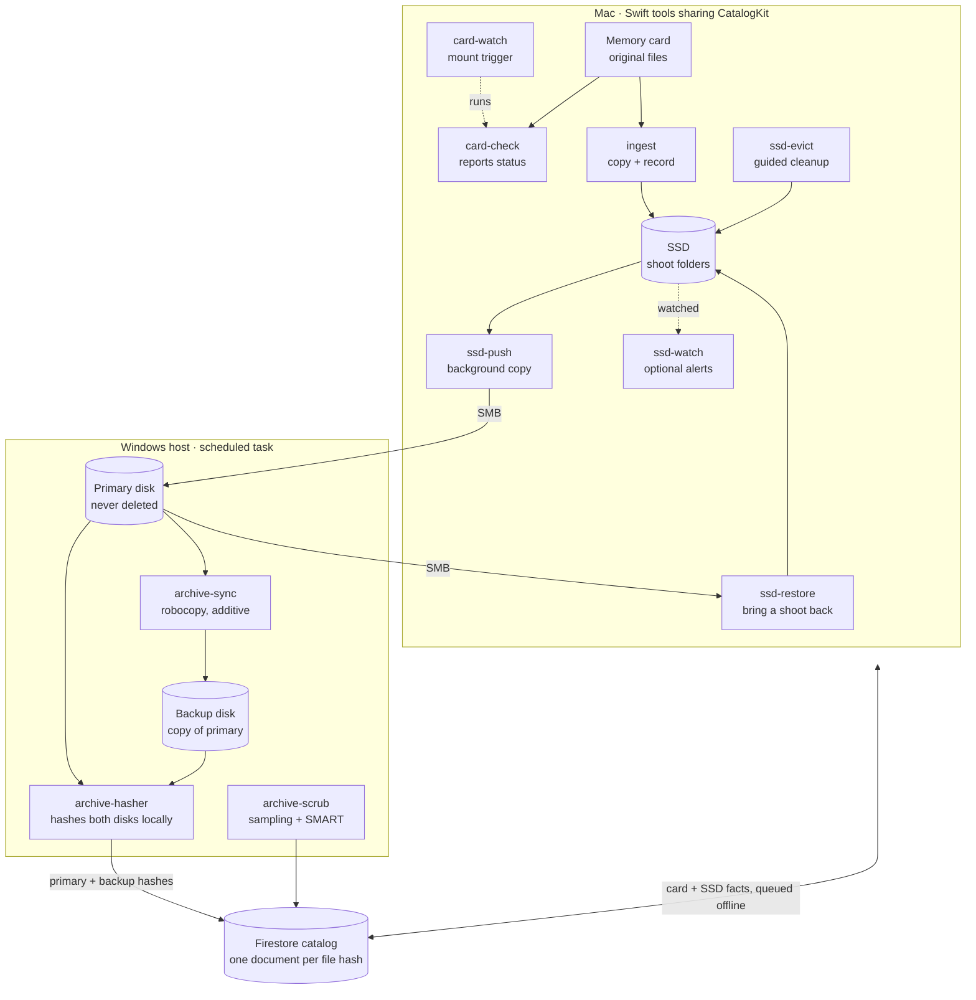

# negatives: Design Doc

Oct 24, 2026 · @Luke

**Contents**

- [Why](#why)
- [Assumptions](#assumptions)
- [Goals and principles](#goals-and-principles)
- [System overview](#system-overview)
- [Data model](#data-model)
- [Folder layout](#folder-layout)
- [Tools](#tools)
- [Safety rules and failure modes](#safety-rules-and-failure-modes)
- [Walkthrough: a card with old and new files](#walkthrough-a-card-with-old-and-new-files)
- [Migrating existing files](#migrating-existing-files)
- [Build order](#build-order)
- [Open questions](#open-questions)

## Why

A memory card is often the only copy of a shoot for days, and today the decision to format it rests on memory. negatives replaces that with one answer based on hashes: this card, this file, is safe to delete, or it isn't.

- **Formatting too early loses work.** Nothing currently proves both archive copies exist and match the card before a format.
- **Formatting too late causes confusion.** A forgotten card ends up with a mix of copied and new files, and re-copying it creates duplicates.
- **Filenames can't be trusted.** DCIM numbering rolls over at 9999 and repeats across cards and cameras, so "I already have DSC00001" means nothing.
- **Existing offload tools stop at the offload.** Hedge and ShotPut Pro verify a copy in the moment, but can't say whether a file is already archived however it got there, or manage a working SSD against verified backups.
- **Editing shouldn't wait for backups.** Work starts on the SSD immediately, and SSD space is freed only when it's provably safe.

## Assumptions

The design is built around one person's home setup: a Mac for editing and a Windows machine holding the archive, which the Mac reaches over SMB network shares.

**Expected workflow**

- Shoots produce both photos and video, from cameras of several brands, on cards that are reused after formatting.
- After a shoot, a card goes into the Mac, its files land on the local SSD, and editing starts right away in desktop photo and video apps that work directly on the files in the shoot folder.
- Originals aren't intentionally modified, and editing apps leave raw and video files untouched. They do create new files in the shoot folder (metadata sidecars, panoramas, rendered videos, project files), and some write ratings and metadata directly into JPEG and DNG files.
- The Mac is sometimes offline, for example while traveling, so ingest must work without a connection.
- The Windows machine is usually on at home, hosts the primary and backup disks, and runs scheduled tasks. It isn't always on, but it must be on for new files to reach the archive; until then they simply stay Pending.
- The SSD is much smaller than the archive, and space on it is freed only when you decide to, a whole shoot folder at a time. The assumption is that a single shoot always fits on the SSD.
- The working SSD is formatted APFS, so working copies can be clones of the locked originals. ingest refuses to run on any other file system.
- Shoot folder names and paths are the same on the SSD and on the archive.
- Cards sometimes sit unformatted for a while, or an old card turns up later.
- The archive holds on the order of millions of files and tens of terabytes. Loading them into Firestore the first time goes beyond the free daily write quota, so that one-time load is paid; ongoing use fits the free tier.

**Backup principles**

- **3-2-1:** three copies (primary, backup disk, online backup), on two kinds of storage (local disks and cloud), with one offsite (the existing online backup). The primary and backup disks share one machine, so they protect against a disk failure, not theft, fire or a power surge; the online backup covers those.
- **A copy isn't a backup until it's verified.** Every copy is checked by hash against the bytes that came off the card, at the place the bytes live.
- **The card is a copy until it's formatted.** It stays the safety net until both archive copies are verified.
- **The working SSD is never a backup.** It's where editing happens, and it may hold changes that aren't archived yet.
- **Backups are additive.** Mistakes on one copy, such as a deletion or an overwrite, must not spread to the others. This assumes the online backup also keeps deleted and older versions. It's hash-based, so moving or renaming files doesn't re-upload them.
- **Restores should be tested.** Occasionally pull a file back from each copy to confirm it opens.

## Goals and principles

A memory card is only cleared once every file on it has a hash-verified copy on both the primary and the backup archive disk. Editing can start from the SSD before that point.

**Goals**

- Know, for any card, which files are safe to delete, which are pending, and which were never copied, regardless of when or how they were copied.
- Verify every copy with an MD5 that matches the hash read from the card.
- Start editing from the SSD immediately; never wait on archive copies.
- Free SSD space only when you ask, through a guided review that deletes nothing but files verified on both archive disks.
- Record ingests while offline (Mac) and sync them later.

**Non-goals**

- Online/cloud backup of the archive. Existing cloud backup software already handles it.
- RAID or block-level replication. The archive stays plain file copies.
- Formatting cards. Tools say when a card is safe; the camera does the format.
- Managing edits, catalogs or sidecars, beyond archiving them as derived files.
- Shoots larger than the SSD. ingest refuses a card that won't fit, so such a shoot would need a direct-to-archive path, left for later if it ever comes up.

**Principles**

- **Small single-purpose tools.** Each component does one job, runs on its own, and talks to the others only through the catalog.
- **Identity is the hash.** Filenames and paths are attributes, never identity.
- **Append-only facts.** Components record what they observed; they never edit another component's facts.
- **Fail safe.** Any missing, stale or unreadable fact means "not safe yet", never "safe".
- **Verify where the bytes live.** Archive hashes are computed on the Windows host from local disks, never read back over SMB.

## System overview

Ten small tools on two machines share one Firestore catalog, plus one manual utility for old Lightroom catalogs (see [lrcat-pack](tools/lrcat-pack.md)). The Mac tools copy and record what they saw; only the Windows hasher, reading the disks locally, can make a file Safe.



The Mac never decides a file is Safe on its own. It reads that from facts the Windows host publishes after hashing both disks.

**Why an online catalog.** Every copy of every file is recorded by content hash in one catalog that both machines can reach from anywhere. That answers questions a folder of files can't:

- *Is this file already safe?* For any file on any card, however long ago and by whatever means it was copied, regardless of its name or path.
- *Which cards can I format?* Even an old card found in a drawer, or one with a mix of copied and new files.
- *What can I free from the SSD?* Decided from verified facts, not from remembering what was backed up.
- The machines coordinate without talking to each other directly: the Mac records what it copied (offline too, syncing later), the archive host records what it verified, and each reads the other's facts.
- The catalog lives outside both machines, so it survives losing either one, and it keeps history such as card sessions and per-card errors.

**How this differs from existing tools.** Offload tools such as Hedge and ShotPut Pro verify a copy at the moment it's made, one session at a time. Photo importers typically spot duplicates by filename, date and size rather than content. Sync and backup tools (robocopy, rsync, online backup) copy and protect files but never check them against what came off the card. negatives keeps a lasting, content-addressed record of every verified copy, keeps re-verifying the archive over time, and answers the card-centric question none of them do: is it safe to format this card?

## Data model

The catalog is one Firestore collection, `files`, with one document per unique file content, keyed by its MD5 (lowercase hex). Each component owns specific fields and writes them with set-with-merge, so concurrent writers never overwrite each other and replayed writes are harmless.

| Field | Contents | Written by |
| --- | --- | --- |
| `size` | Bytes | First writer (identical for all) |
| `cards.<cardKey>` | Card ID, relative path on card, time seen | card-check, ingest (Mac) |
| `primary.<pathKey>` | Archive-relative path, size, mtime, verified-at | archive-hasher (Windows) |
| `backup.<pathKey>` | Archive-relative path, size, mtime, verified-at | archive-hasher (Windows) |
| `ssd.<pathKey>` | Working and .originals paths, size and mtime at ingest, copied-at, pushed-at | ingest, ssd-push, ssd-evict (Mac) |

Other collections:

- `status/archive-hasher`: last run start, last success, files published. It also holds the watcher's heartbeat. The Mac warns when the heartbeat is older than a few hours or the last full run is older than about a day and a half.
- `conflicts`: a path whose content changed on primary, or a backup file whose hash never matches. Written by Windows, resolved by hand.
- `cardSessions`: one document per card session (volume UUID, shoot folder, card folder, camera model, first ingest, plus a few file paths and sizes for confirmation). Written by ingest.

**Keys and paths**

- `pathKey` is a short hash of the normalized path, because Firestore field names can't safely hold slashes. The full path lives in the value.
- Paths are stored relative to the archive or SSD root, with `/` separators and Unicode NFC. macOS often produces NFD filenames, which otherwise won't match what Windows reports for the same file.
- `cardKey` is the card's volume UUID. It stays the same until the card is formatted, so a re-inserted card is recognized and can continue its previous shoot. A format creates a new UUID, which counts as a new card.

**Derived states** (computed by readers, never stored)

| State | Rule |
| --- | --- |
| Safe | A `primary` entry and a `backup` entry, both verified |
| Pending | Seen on a card or SSD, but missing one or both verified archive entries |
| Not copied | No document for the hash |

All writes are merges of facts, so no write needs a transaction. That's what lets the Mac queue writes offline.

## Folder layout

Every card keeps its own folder structure (DCIM, PRIVATE/M4ROOT and so on) inside a per-card folder, so DCIM's 9999-file rollover and two cards with the same paths never collide. On the Mac, everything for a shoot lives in its shoot folder: working copies at the card paths, and the locked pristine originals at the same paths inside a hidden .originals/ folder, so moving, freeing or restoring a shoot means one folder. On the archive, each shoot folder holds its own Originals/ and Derived/ folders, and a small .negatives marker file tells the tools it's a negatives shoot.

**Mac SSD**

```text
EditSSD/
└── Shoots/
    └── 2026-10-18 Coast/                 everything for one shoot
        ├── .originals/                   pristine originals, locked, hidden
        │   ├── ILCE-7M4-01/DCIM/100MSDCF/DSC09998.ARW
        │   └── ILCE-7M4-02/…
        ├── ILCE-7M4-01/                  working copies (APFS clones), editable
        │   ├── DCIM/100MSDCF/DSC09998.ARW
        │   ├── DCIM/101MSDCF/DSC00001.ARW
        │   └── PRIVATE/M4ROOT/CLIP/C0001.MP4
        ├── ILCE-7M4-02/
        └── Exports/                      derived work, anywhere in the shoot
            └── coast-pano.tif
```

**Windows primary** (the backup disk mirrors it)

```text
P:\
├── 2026-10-18 Coast\                    a negatives shoot
│   ├── .negatives                       marker file
│   ├── Originals\                       from .originals, never overwritten
│   │   └── ILCE-7M4-01\DCIM\100MSDCF\DSC09998.ARW
│   └── Derived\                         changed or new files from Shoots/, replaceable
│       ├── ILCE-7M4-01\DCIM\100MSDCF\DSC09999.JPG   rated JPEG, same position
│       ├── ILCE-7M4-01\DCIM\100MSDCF\DSC09998.xmp   sidecar
│       └── Exports\coast-pano.tif
└── 2019-05-04 Beach\                    a legacy shoot, left as it was
```

**Legacy shoot folders**

Shoot folders from before negatives sit alongside new ones, on the SSD and on the archive, with the same names and paths in both places. The tools tell them apart one folder at a time:

- On the SSD, a shoot folder with a `.originals/` folder is new-style; one without it is legacy. On the archive, the `.negatives` marker plays the same role.
- A folder the catalog knows as new-style but that has lost its `.originals/` is flagged, never silently treated as legacy.
- Legacy shoots are still archived and cataloged: ssd-push copies them to the same paths on the archive (see [ssd-push](tools/ssd-push.md)), and ssd-evict checks them by hash.

**Naming**

- **Shoot folder:** the latest capture date on the card, plus an optional description you type at ingest (`2026-10-18 Coast`).
- **Card folder:** the camera model from the files' EXIF plus a counter within the shoot (`ILCE-7M4-01`, `DJI-Mini4-01`). Every brand writes a Model tag.
- **Windows-safe names:** ingest rejects names containing `: * ? " < > |` or ending in a space or period, before copying anything.

**Card sessions**

- ingest looks up the card's volume UUID in `cardSessions`. A match only counts if a few files on the card match the session's recorded paths and sizes. Otherwise it's a new session, which covers rare UUID collisions and offline cache misses.
- **Confirmed match:** skip files already ingested. If the card also has new files, always ask where they go: continue the previous shoot in the same card folder (an incomplete copy) or start a new shoot with its own folders. The prompt shows how many new files there are and their capture dates, with a Preview button that opens the first new file (earliest capture) in Quick Look.
- **New session:** take the next free counter for that camera model within the shoot. Counters come from `cardSessions`, not the SSD, so a number is never reused after ssd-evict frees a folder.
- **Formatted card:** gets a new UUID, so it's always a new session.
- **Mixed-camera card:** named after the first camera model found on it.
- **Physical card ID:** each card carries a short ID written on it: a letter for the card type plus a sequence number, such as S01 for SD or C01 for CFexpress. Write it with a fine permanent marker on the label, away from the contacts, or on the case for tiny cards. Numbers are never reused, even after a card is retired.
- At the start of a new session, ingest asks for the ID, suggests the last one seen with that card's capacity, and allows skipping. It's stored in `cardSessions`, so card-check notifications can name the card and a per-card history (sessions, read errors, hash mismatches) can show one that is going bad. It never affects folder names.

## Tools

Each tool has its own spec in [`docs/tools/`](tools/). All of them share the [data model](#data-model), [folder layout](#folder-layout) and [safety rules](#safety-rules-and-failure-modes) in this doc.

**Mac** (Swift; each runs alone, and none depends on another having run first)

| Tool | Role |
| --- | --- |
| [CatalogKit](tools/catalogkit.md) | Shared library: Firestore access with an offline queue, schema, path normalization, hashing |
| [card-check](tools/card-check.md) | Read-only report: is each file on a card Safe, Pending or Not copied |
| [card-watch](tools/card-watch.md) | Runs card-check when a card mounts and offers Ingest |
| [ingest](tools/ingest.md) | Copies a card into a shoot folder on the SSD |
| [ssd-push](tools/ssd-push.md) | Copies originals and derived files to the primary disk in the background |
| [ssd-evict](tools/ssd-evict.md) | Guided, user-run removal of whole Safe shoots from the SSD |
| [ssd-restore](tools/ssd-restore.md) | Brings an archived shoot back to the SSD |
| [ssd-watch](tools/ssd-watch.md) | Optional alerts if a locked original changes |

**Windows** (none of them ever deletes from the primary disk)

| Tool | Role |
| --- | --- |
| [archive-sync](tools/archive-sync.md) | Copies primary to backup, additive only |
| [archive-hasher](tools/archive-hasher.md) | Hashes both disks locally and publishes verified facts |
| [archive-scrub](tools/archive-scrub.md) | Nightly sampled re-hashing and SMART checks |
| [Credentials and scheduling](tools/windows-scheduling.md) | Service account, write-triggered and nightly runs, manual trigger |

**Manual utility**

| Tool | Role |
| --- | --- |
| [lrcat-pack](tools/lrcat-pack.md) | Packs old Lightroom catalogs into single zip files |

## Safety rules and failure modes

Every failure below leaves a file in Pending, never in Safe.

**Rules**

1. A card is safe to format only when every file on it is Safe, checked online against a fresh catalog.
2. A file leaves the SSD only when you confirm it and a fresh re-hash shows it is Safe.
3. Nothing deletes from the primary disk, and only files in a shoot's Derived/ folder are ever overwritten there. The one exception is lrcat-pack, which removes packed catalog files only when run by hand and confirmed.
4. Nothing on the backup disk is deleted. A partial copy is moved to quarantine, and only when the primary copy is verified good, then recopied.
5. Archive hashes come only from archive-hasher reading local disks.

**Failure modes**

| Failure | Effect | Handling |
| --- | --- | --- |
| Interrupted robocopy copy | Partial file on backup | Reconcile moves it to quarantine (never deletes it); next run recopies |
| Corrupt write to primary over SMB | Primary hash differs from card hash | Stays Pending; re-ingest from the card |
| Scheduled task stops running | Catalog goes stale | Mac warns on stale status; nothing becomes Safe |
| Mac offline | Writes queue locally | No format or evict decisions until online |
| Original edited in place on primary | Same path, new content | Reported to `conflicts`; backup keeps the original |
| Same file on two cards | Same hash, two card sightings | One document; both cards show it as copied |
| Service account key leaked | Full Firestore read/write | Isolated project; rotate the key. Disks are unaffected |

## Walkthrough: a card with old and new files

A card that was ingested before but never formatted, then used again, is handled without duplicates when online. Offline it is still safe, but may copy some files twice.

**Online (Firestore reachable)**

1. card-watch sees the card mount and runs card-check, which hashes every file and looks each hash up in the catalog.
2. Each file lands in one of three groups: **Safe** (archived and verified on both disks), **Pending** (ingested earlier but not yet verified, for example because the Windows machine was off) or **Not copied** (new since the last ingest). The notification shows the counts and says the card isn't safe to format.
3. You click Ingest. ingest finds the card's volume UUID in `cardSessions`, confirms it by checking a few recorded files, and, because the card has both old and new files, asks whether to continue in the same shoot and card folder (an incomplete copy) or start a new shoot with its own folders. The prompt shows the new files' count and capture dates, plus a Preview button that opens the first new file in Quick Look.
4. Only the Not copied files are copied, to `.originals/` and as clones in the shoot folder. Safe and Pending files are skipped by hash, even if their shoot folder was already removed from the SSD. That's safe because the live catalog already records each of their hashes: a Safe file has verified copies on both archive disks, and a Pending file still has its locked copy in `.originals/` on the SSD (ssd-evict never removes a shoot until it's Safe) on its way to the archive. Copying either again would only make a duplicate.
5. ssd-push sends the new originals to the primary disk; archive-sync and archive-hasher copy and verify them. The next time the card is inserted, the notification says it's safe to format.

**Offline (Firestore unreachable)**

1. card-check still hashes every file, but can only look hashes up in the local Firestore cache. Files this Mac ingested or checked recently are recognized; older ones may not be in the cache, so they show as "not known offline" rather than Not copied. It never says the card is safe to format.
2. ingest looks up the card's session in the cache. If found and confirmed, it asks the same continue-or-new question, and if you continue, any file already present in that shoot's `.originals/` folder with the same path and size is skipped, so files from the earlier session aren't copied again.
3. If the session isn't in the cache, ingest starts a new card folder, and old files not on the SSD are copied again. That's safe but uses extra space.
4. Sightings and new `ssd` facts queue locally and sync when the Mac is back online. Then ssd-push finds that re-copied old files already exist on primary with the same hash, so it pushes nothing for them, and ssd-evict can later remove the duplicate folder once it's Safe.

## Migrating existing files

Existing folders stay where they are. Every shoot folder without a .negatives marker is treated as legacy: hashed and protected like Originals/. Only new ingests use the new layout.

**Windows (do this first)**

1. **Pack old Lightroom catalogs** with lrcat-pack on both disks (see [lrcat-pack](tools/lrcat-pack.md)). It removes millions of small files before the first hash, which then runs much faster.
2. **Leave existing folders at the root** of both disks. Each old shoot folder stays whole, never split into Originals and Derived; their cards were formatted long ago, so they're simply protected and verified as they are. Check that no old shoot folder already contains a folder named Originals or Derived. Edits to a restored old shoot go to a Derived folder inside it.
3. **Check that primary and backup match** before turning anything on: run archive-sync in report-only mode (robocopy `/L`) and resolve differences by hand.
4. **Nothing to create:** each new shoot's folder, with its Originals and Derived folders, is created by its first push.
5. **Run the first full hash by hand** (days; see [scheduling](tools/windows-scheduling.md)), then enable the scheduled task and the watcher.
6. **Check the card drawer:** insert old cards and let card-check report which are already safe to format.

**Mac**

1. **Confirm the SSD is APFS** with `diskutil info`. If it isn't, wait until everything on it is verified on the primary disk, copy it off, reformat as APFS, and copy it back.
2. **Keep existing working folders in `Shoots/`**, named exactly as on the archive. They're legacy shoots: ssd-push archives anything missing or changed, and ssd-evict removes one once every file in it is Safe. Files you changed show as Pending until their Derived copy is verified.
3. **Keep any Lightroom catalog outside `Shoots/`**, so its previews never get pushed as derived files.
4. **Don't create `Shoots/` or any shoot folder yourself.** ingest creates them on the first card.

## Build order

Each step ships something usable on its own, and the read-only card check arrives before anything that copies or deletes.

1. **Spike: Firestore on macOS.** Sign in, write offline, quit, reconnect, confirm the write lands. This validates the riskiest assumption first. Also confirm the SSD is APFS so ingest can clone.
2. **archive-sync.** Replaces any existing copy job; test interrupted copies with a large video. Run lrcat-pack before this step, so the first hash skips the catalog clutter.
3. **Schema spec + archive-hasher.** Write the field and path-normalization spec, then the hasher. Run the first full hash by hand.
4. **CatalogKit + card-check.** Immediately answers "is this old card already archived?" for every card in the drawer.
5. **ingest + ssd-push.** Card to SSD with sightings recorded, then ssd-push copies the SSD to primary in the background. ssd-watch is optional and can come last.
6. **ssd-evict.** The guided review and listings first; deletion is added once the listings look right.

## Open questions

- [ ] **Existing archive:** answered: millions of files and tens of terabytes, so the first hash run takes days (see [scheduling](tools/windows-scheduling.md)); the initial Firestore load is a one-time paid cost.
- [ ] **Existing layout:** answered: existing folders stay at the root of each disk as legacy folders (see Migrating existing files).
- [ ] **Exclude list:** researched; a starting list is in [ssd-push](tools/ssd-push.md). Still to confirm with a test shoot: Catalyst metadata edits and Lightroom catalog placement.
- [ ] **Interface:** answered: triggered automatically when a card mounts, with a notification (see [card-watch](tools/card-watch.md)).
- [ ] **SSD cleanup:** answered: by shoot folder, and only whole shoot folders are ever removed.
- [ ] **Card tracking:** answered: yes, with a short physical ID per card (see Card sessions).
